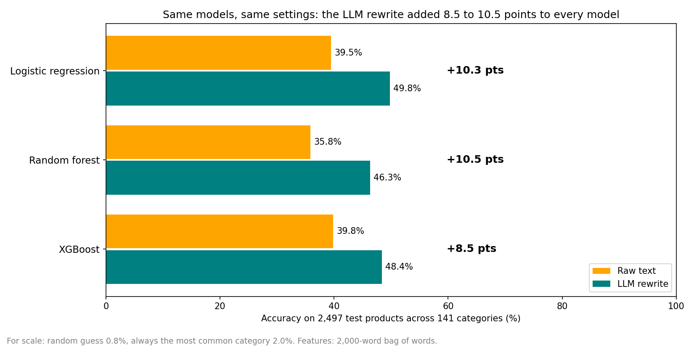
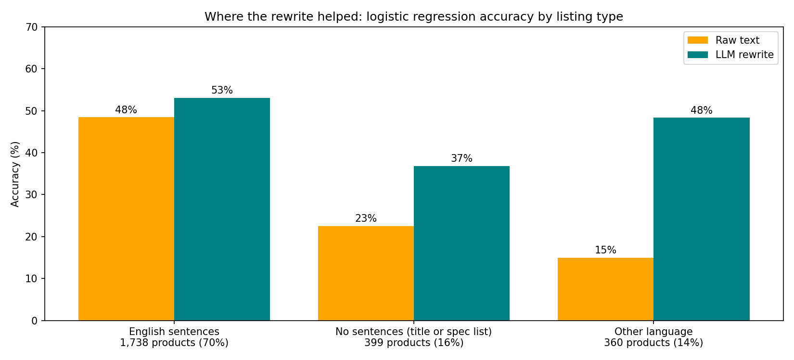
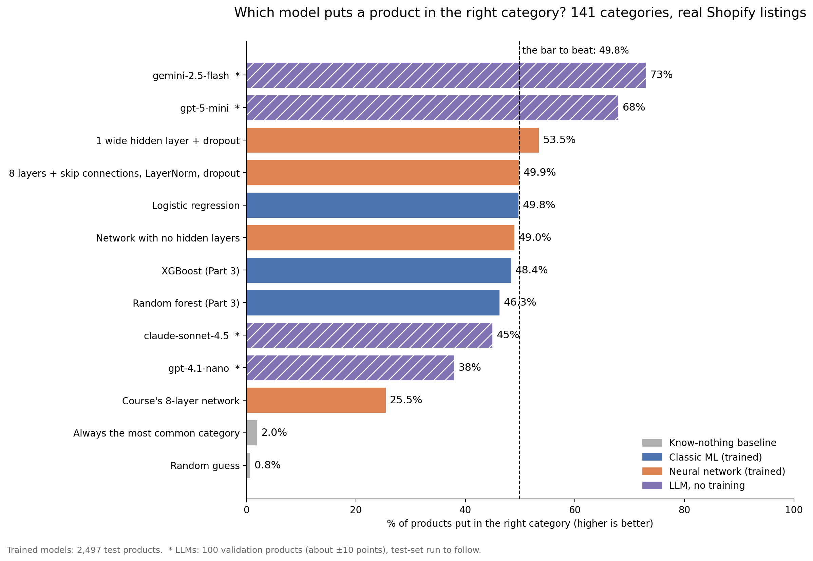
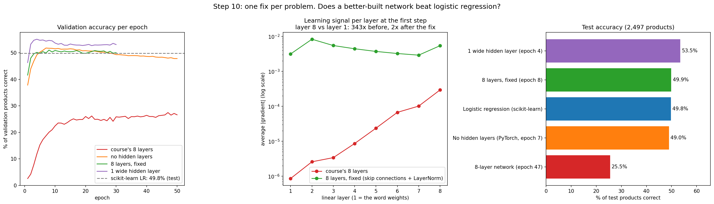
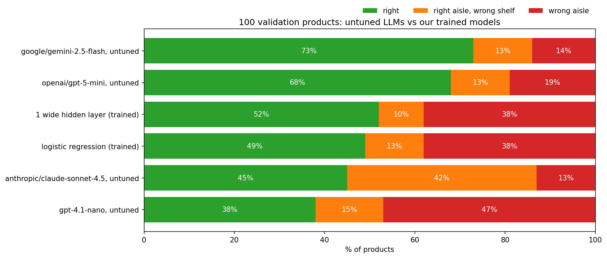

# Catalogue Curation: what a real product catalogue looks like before RAG can trust it

Applying data-curation practice to a real public product catalogue ([Shopify/product-catalogue](https://huggingface.co/datasets/Shopify/product-catalogue), Apache-2.0), and publishing the result as a clean, balanced dataset for product categorisation.

**Dataset:** [raghu619/shopify_category_lite](https://huggingface.co/datasets/raghu619/shopify_category_lite) · 25,022 products · 141 categories · 20,027 / 2,498 / 2,497 train / validation / test · now includes an LLM-rewritten `summary` column

## Why this project exists

In my previous project, [StyleSense](https://github.com/raghu619/stylesense-rag), the thesis was: **budgets are a WHERE clause, vibes are a vector.** An LLM parses hard constraints (budget, category, gender) into a metadata filter, and only the taste part is embedded.

That filter only works if every product carries **clean metadata**. StyleSense got it for free from a synthetic catalogue with controlled enums. Real catalogues don't work that way. So the next question was:

> Where does the metadata a RAG filter depends on actually come from, and can it be trusted?

This project answers that for one field, **product category**, using the data-curation techniques from Week 6 of the LLM Engineering course (originally applied there to Amazon price prediction). It is also the curated training set for fine-tuning a category classifier later.

## Task

**Input:** product title + description → **Output:** level-2 category (e.g. `Home & Garden > Decor`)

## What the data was hiding


1. **The answer was in the input, every time.** The source's `potential_product_categories` column contains the correct category for **100%** of products, and for **23.5%** every candidate points to the right answer. The dataset was built for a *pick-from-a-list* task. Using that column for *read the product and name the category* would measure the wrong thing. **Excluded.**
2. **My first cleaning rule was wrong.** A phone-number regex matched **1,813** products. Printing the matches showed product IDs, model years and **clothing size ranges** (`26-29 32.25`). It was deleting exactly the attributes a stylist needs. A keyword-anchored rule found the **74** real phone numbers. A cleaning rule is a hypothesis until you read what it matched.
3. **Contact details in a public dataset:** 283 products contained email addresses and 300 contained URLs. Removed before publishing.
4. **Placeholder products:** titles like `example product` appeared with 2 to 3 different labels (store template items). **29 products removed.**
5. **Duplicates were rarer than expected** (32 removed after merging splits, 0.07%). I predicted duplicates would be the big story; they weren't. One duplicate only appeared *after* text cleaning (two configurations of the same cubicle panel, identical once truncated) and leaked across splits. Lesson: re-check duplicates after any step that changes the text.
6. **The categories a stylist needs are the thinnest.** `Luggage & Bags > Tote Bags` had 3 products; all of Apparel & Accessories was 4.4% of the catalogue.

## Curation funnel


| Step | Products |
|---|---|
| Raw (train + test) | 48,289 |
| Valid level-2 label (non-product labels and 1-level paths removed) | 48,135 |
| Conflicting / placeholder titles removed | 48,106 |
| Deduplicated (normalised title + description) | 48,074 |
| Classes with 20+ products | 47,550 |
| Classes capped at 500 | 25,023 |
| Cross-split leak removed | 25,022 |

## Decisions and trade-offs

| Decision | Why | Trade-off |
|---|---|---|
| **Label = level 2** of the category path | Level 1 is too broad for a filter; at level 3, 4 of 5 classes had under 20 products | Loses fine distinctions (e.g. Piggy Banks vs Money Jars) |
| **Drop classes under 20 products** | Too few examples to learn | 61 niche classes not covered |
| **Cap classes at 500** | Biggest class share falls from 10.6% to 2.0% | Discards ~half the usable data; test scores reflect a balanced catalogue, not the real mix. A production classifier would keep everything and use class weights |
| **Truncate descriptions at 1,000 chars** | Fine-tuning is billed per token; median description is ~500 chars | 28% of descriptions lose their tail |
| **Keep empty descriptions** | The title carries the signal ("Airplane Piggy Bank") | ~7% of products rely on the title alone |
| **Keep all languages** | Real catalogues are multilingual (~9% Spanish, some French) | Language estimate is a heuristic, not a detector |
| **Stratified split after all cleaning** | Every class in every split; no text in two splits | |


## Mapping to the course concepts

| Week 6 Day 1 (Amazon prices) | This project (Shopify categories) |
|---|---|
| Missing prices | Empty descriptions (no nulls, but 2,743 blank) |
| Right-skewed prices | Long tail of classes |
| Price cap at $999 | Minimum 20 products per class |
| Weighted sampling (`p**2`) | Per-class cap |
| Part-number regex bug | Phone-number regex bug |
| Ratings excluded (not available at prediction time) | Candidate list excluded (contains the answer) |
| Exact-match dedup | Normalised dedup, plus a re-check after cleaning |

## Run it

```bash
pip install pandas pyarrow huggingface_hub matplotlib numpy tqdm openai python-dotenv scikit-learn xgboost torch
jupyter notebook 01_curation.ipynb   # Part 1: curation
jupyter notebook 02_rewrite.ipynb    # Part 2: LLM rewrite
jupyter notebook 03_baselines.ipynb  # Part 3: baselines (no API key, about 3 minutes)
jupyter notebook 04_nn_and_untuned_llm.ipynb  # Part 4: neural networks + LLMs with no training
```

Every step records its row count in `funnel`, and every cleaning rule prints real examples of what it matched before it is applied.

Part 2 reads the curated dataset from Hugging Face, so it runs without Part 1's local files. It needs an `OPENAI_API_KEY` in a `.env` file: change the `load_dotenv(...)` path in Cell 1 to point at yours. A full run costs about $0.77 through the Batch API and can take up to 24 hours. The last cell pushes to the dataset repo, so change `REPO_ID` to your own (and log in with `huggingface_hub.login()`) before running it.

Part 3 also reads the dataset from Hugging Face and needs no API key. On a Mac, XGBoost may need `brew install libomp`.

Part 4 also reads the dataset from Hugging Face. Part A (the neural networks) needs PyTorch but no API key, and trains every network in about 2 minutes on a laptop CPU. Part B needs an `OPENAI_API_KEY` for gpt-4.1-nano (about 1 cent) and an `OPENROUTER_API_KEY` for the other LLMs (about $1.15 for the 100 products, mostly Claude Sonnet 4.5). Edit `OTHER_MODELS` in Step 13 to change or drop models.

## Part 2: Rewriting every product with an LLM

Notebook: [`02_rewrite.ipynb`](02_rewrite.ipynb) · Prompt: [`prompts/rewrite_v2.txt`](prompts/rewrite_v2.txt)

Product listings are messy: long marketing text, codes, six languages. A common fix before fine-tuning is to have a cheap LLM rewrite every product into one short, standard format. Instead of assuming it helps, I measured it.

Every product was rewritten by **gpt-4.1-nano** through the **OpenAI Batch API** (50% cheaper, results within 24h) into:

```
Title: ...
Brand: ... (or Unknown)
Description: one sentence (or Unknown)
Details: one sentence on key features (or Unknown)
```

**One deliberate change from the course template:** the course prompt asks for a `Category:` line. In this project the category is the label, so that line would put the answer straight back into the input. It was removed.

### Results (all 25,022 products)

| Check | Result |
|---|---|
| Bad format | 0 |
| Median length | 575 -> 260 characters (55% shorter) |
| Invented numbers flagged | 358 (1.43%). Hand-labelling 20 showed ~25% were real inventions, the rest unit or year conversions, so roughly 0.35% |
| Description = Unknown | 391 (1.56%); 73 had real descriptions (mostly books and plants, a known limitation) |
| Languages | Spanish, French, German, Italian, Portuguese and Japanese translated to English |
| Cost | $0.77 for the final run (about $1.64 including experiments) |

### Three prompts and 10 lines of code


1. **Prompt v1 invented facts.** A rolling paper listed as `12,5 cm` (German decimal comma) became "quantity of 12 sheets", despite the rule "never invent facts". It also missed obvious brands.
2. **Prompt v2 fixed both** and ran on every product. It left 52 broken outputs, and some books described as "Unknown" (an over-applied rule written for a one-word listing).
3. **Prompt v3 fixed the books and passed a 100-product test.** On all 25,022 products it was worse: Description = Unknown rose from 1.56% to 2.50% and flagged invented numbers from 1.43% to 1.73%. Rejected.
4. **The broken outputs were fixed by code, not a prompt:** `clean_summary()` enforces the 4-line format. Final dataset: **prompt v2 + `clean_summary()`**.

### What I learned

- **A rule in a prompt is a request, not a guarantee.** If code can guarantee something, use code.
- **Every prompt fix has side effects.** Each version solved the failure in view and created a new one elsewhere.
- **Small tests can't see small side effects.** A 100-product sample showed no difference between v2 and v3; the full dataset did.
- **Check your checks.** My number checker misread thousands separators (`105,931`) and Japanese full-width digits (`５０`) before I fixed it. Hand-labelling a sample measured how often it was right.
- **Re-run, don't patch.** Mixing outputs from two prompts would mean training on one style and predicting on another (train/serve mismatch). At $0.85, re-running everything was the right call.


### Next

Does the rewritten text actually train a better category model than the raw text? Answered in [Part 3](#part-3-baselines-before-frontier-models): yes, by 8.5 to 10.5 points for every model.

## Part 3: Baselines before frontier models

Notebook: [`03_baselines.ipynb`](03_baselines.ipynb)

StyleSense's metadata filter (`WHERE category = ...`) only works if every product carries a correct category. Real catalogues don't guarantee that, so the system needs a model that reads a product and fills in its category. Before trying frontier LLMs (Week 6 Day 4), this part answers two questions: what do cheap, classic models already get, and does Part 2's $0.77 rewrite help them?

**Setup:** the course's features (a 2,000-word bag of words) and models, with identical settings for both inputs. Only the input changes: raw `text` vs rewritten `summary`. Scores are on the 2,497 test products; XGBoost's early stopping uses the validation set. The course predicts a price and this project predicts one of 141 categories, so each Day 3 model has a classification twin (`LinearRegression` becomes `LogisticRegression`, and so on).

### Results



| Model | Raw text | LLM rewrite | Gain | Macro-F1 (raw → rewrite) | Training time |
|---|---|---|---|---|---|
| Random category | 0.8% | | | | |
| Most common category | 2.0% | | | | |
| Logistic regression | 39.5% | **49.8%** | +10.3 pts | 0.334 → 0.418 | 5s |
| Random forest | 35.8% | 46.3% | +10.5 pts | 0.234 → 0.364 | 2 to 3s |
| XGBoost | 39.8% | 48.4% | +8.5 pts | 0.313 → 0.400 | 54 to 58s |

1. **The rewrite helped every model by 8.5 to 10.5 points**, even though it's 55% shorter.
2. **The simplest model won.** Logistic regression matched or beat both tree models in a fraction of the time. That's the opposite of the course's price project, where the trees won.
3. **The input mattered more than the algorithm:** about 10 points from changing the text, at most about 4 from changing the model.

### Where the rewrite helped



| Listing type (rough heuristic) | Share of test products | Raw text | Rewrite |
|---|---|---|---|
| English sentences | 70% | 48.4% | 53.0% |
| No sentences (title or spec list) | 16% | 22.6% | 36.8% |
| Other language | 14% | 15.0% | **48.3%** |

**Translation gave the biggest gain.** Listings in other languages are 14% of the test products but account for almost half of the net gain (120 of the 257 extra correct answers). The raw-text model filed a German listing for mango buttermilk under *Hardware > Building Consumables*; with the rewrite it chose *Food, Beverages & Tobacco > Beverages*. The rewrite isn't all upside, though: it fixed 483 test predictions and broke 226.

### What I learned

- **Baselines give every later number a meaning.** 49.8% sounds weak until you know random guessing gets 0.8% across 141 categories.
- **Fewer, cleaner words beat more, noisier ones:** a median of 14 vocabulary words per product beat 23.
- **The course's winner isn't always yours.** Text evidence adds up word by word, which suits a linear model.
- **Notebooks hide state.** Re-running a cell added a duplicate result and broke the results table. The fix went into the code, and the published notebook was re-run top to bottom.

### Next

A classic model gets about half the categories right: not enough to trust as a filter on its own. The rewrite is the bigger lever, but it costs an LLM call for every product, at training time and at serving time. So Day 4 compares **rewrite + a cheap classifier** against **a frontier model classifying the product directly**, on the same 2,497 test products.

## Part 4: Neural networks and untuned LLMs

Notebook: [`04_nn_and_untuned_llm.ipynb`](04_nn_and_untuned_llm.ipynb)

Week 6 Day 4 of the course moves from traditional ML to neural networks to LLMs. This part asks two questions on our 141 categories: does the course's neural network beat Part 3's 49.8%, and how good is an LLM with no training at all? The second number is the "before" for Day 5, which fine-tunes gpt-4.1-nano.

**Setup:** the same 2,000-word bag of words as Part 3 (logistic regression refitted in this notebook reproduces 49.8% exactly), and the same training loop for every network (Adam, learning rate 0.001, batches of 64, best epoch on validation kept). Each network is scored once on the 2,497 test products.

### Results



| Model (test set, 2,497 products) | Accuracy | Macro-F1 |
|---|---|---|
| Course's 8-layer network | 25.5% | 0.180 |
| Network with no hidden layers | 49.0% | 0.354 |
| Logistic regression (Part 3) | 49.8% | 0.418 |
| 8 layers + skip connections, LayerNorm, dropout | 49.9% | 0.411 |
| **1 wide hidden layer + dropout** | **53.5%** | **0.444** |

1. **The course's 8-layer network scored 25.5%**, half of logistic regression. Deleting its 7 hidden layers nearly doubled it (49.0%).
2. **The notebook measured three problems:** the learning signal reaching the word weights was 343x weaker than at the last layer, the network memorised (96% right on training products, 27.5% on validation), and its confidence meant nothing (right 38% of the time when 90%+ sure, against 88% for logistic regression).
3. **One fix per problem** brought 8 layers back to 49.9%, and one wide hidden layer with dropout reached 53.5%: the first trained model in this project to beat logistic regression.



### Why the same network won in the course

The course's network trained on 800,000 products to predict a single number, the price. Here it has 20,027 products and 141 categories to squeeze through a 64-number layer. A price depends on word combinations ("16GB" next to "laptop" vs "USB stick"), which is what hidden layers learn. A category mostly adds up word by word, which a linear model already does. It wasn't the network, it was the data and the task.

### LLMs with no training: a first look on 100 validation products



Every LLM gets the same prompt: the 141 category names, plus a strict JSON schema that only accepts one of them. An **aisle** is the top level of a category (Apparel & Accessories), a **shelf** the second level (Costumes & Accessories).

| Model (same 100 validation products) | Right | Right aisle, wrong shelf | Wrong aisle | Cost for 2,497 products |
|---|---|---|---|---|
| Gemini 2.5 Flash | **73%** | 13% | 14% | $1.53 |
| GPT-5 mini | 68% | 13% | 19% | $2.20 |
| 1 wide hidden layer (trained) | 52% | 10% | 38% | |
| Logistic regression (trained) | 49% | 13% | 38% | |
| Claude Sonnet 4.5 | 45% | 42% | 13% | $24.72 |
| gpt-4.1-nano | 38% | 15% | 47% | $0.21 |

- **Big LLMs with no training beat every trained model, by 16 to 21 points.** Their misses mostly stay in the right aisle; the bag-of-words models' misses mostly don't.
- **gpt-4.1-nano, the model Day 5 fine-tunes, scored 38%**, below logistic regression. It filed League of Legends cosplay shoes under Shoes; this dataset files them under Costumes. That's a convention, not knowledge, and conventions are what fine-tuning should teach.
- **Claude Sonnet 4.5's score is under review, not a verdict.** 42% right aisle, wrong shelf is three times anyone else's, which points at the strict schema rather than the model. A run without the schema is next.
- With 100 products there's about ±10 points of noise. The run on all 2,497 test products comes next.

### What I learned

- **Deeper isn't better on small data.** The deepest network was the worst model here; one wide layer was the best trained one.
- **Measure before you fix.** Each fix answered a problem the notebook had measured first: a fading learning signal, memorising, overconfidence.
- **Confidence is a feature.** Logistic regression knows when it's right (88% right when 90%+ sure). For a metadata filter, that can matter more than another point of accuracy.
- **Caching beat the Batch API here.** 2,048 of every prompt's 2,190 tokens are the same instructions and category list, so with the cache, normal calls cost about $0.17 for the test set, against about $0.28 at Batch prices without it.

### Next

Day 5 fine-tunes gpt-4.1-nano on the training products. Can a small model that learns this catalogue's conventions close the gap from 38% to the 73% of a big model that only knows the world?

## License and attribution

Code: MIT. Dataset derived from [Shopify/product-catalogue](https://huggingface.co/datasets/Shopify/product-catalogue) (Apache-2.0); the derivative is released under Apache-2.0. Images from the source are not included.
