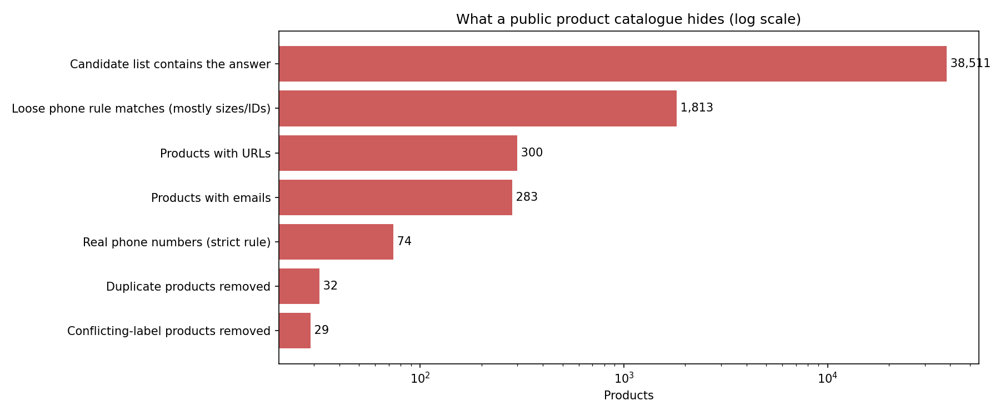
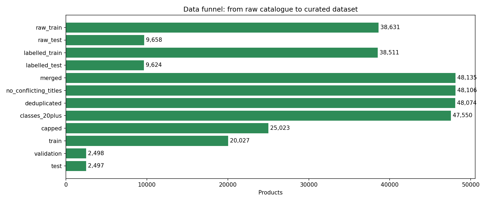
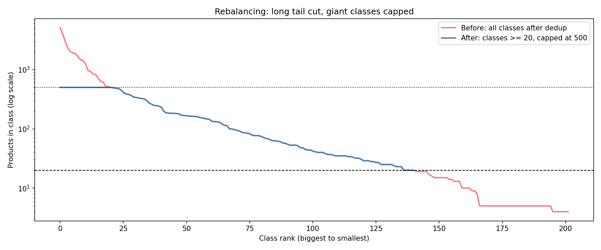
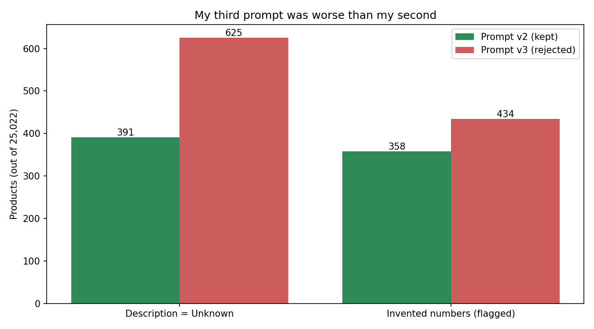
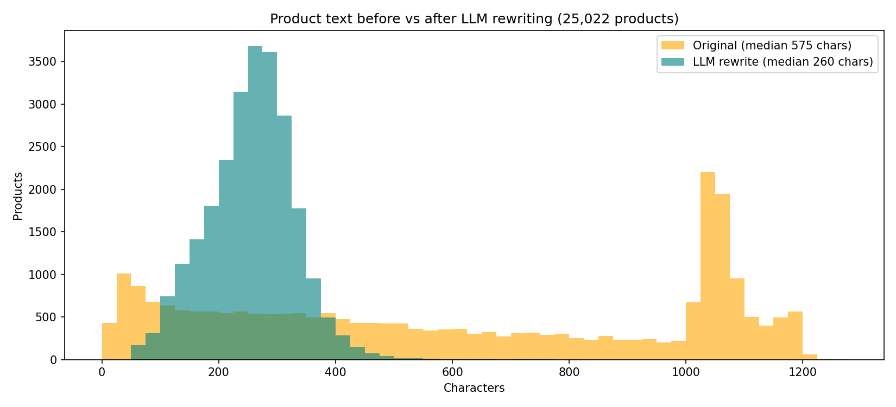

# Catalogue Curation: what a real product catalogue looks like before RAG can trust it

Applying data-curation practice to a real public product catalogue ([Shopify/product-catalogue](https://huggingface.co/datasets/Shopify/product-catalogue), Apache-2.0), and publishing the result as a clean, balanced dataset for product categorisation.

**Dataset:** [raghu619/shopify_category_lite](https://huggingface.co/datasets/raghu619/shopify_category_lite) · 25,022 products · 141 categories · 20,027 / 2,498 / 2,497 train / validation / test · now includes an LLM-rewritten `summary` column

## Why this project exists

In my previous project, [StyleSense](https://github.com/raghu619/stylesense-rag), the thesis was: **budgets are a WHERE clause, vibes are a vector.** An LLM parses hard constraints (budget, category, gender) into a metadata filter, and only the taste part is embedded.

That filter only works if every product carries **clean metadata**. StyleSense got it for free from a synthetic catalogue with controlled enums. Real catalogues don't work that way. So the next question was:

> Where does the metadata a RAG filter depends on actually come from, and can it be trusted?

This project answers that for one field, **product category**, using the data-curation techniques from Week 6 of the [LLM Engineering course](https://github.com/ed-donner/llm_engineering) (originally applied there to Amazon price prediction). It is also the curated training set for fine-tuning a category classifier later.

## Task

**Input:** product title + description → **Output:** level-2 category (e.g. `Home & Garden > Decor`)

## What the data was hiding



1. **The answer was in the input, every time.** The source's `potential_product_categories` column contains the correct category for **100%** of products, and for **23.5%** every candidate points to the right answer. The dataset was built for a *pick-from-a-list* task. Using that column for *read the product and name the category* would measure the wrong thing. **Excluded.**
2. **My first cleaning rule was wrong.** A phone-number regex matched **1,813** products. Printing the matches showed product IDs, model years and **clothing size ranges** (`26-29 32.25`). It was deleting exactly the attributes a stylist needs. A keyword-anchored rule found the **74** real phone numbers. A cleaning rule is a hypothesis until you read what it matched.
3. **Contact details in a public dataset:** 283 products contained email addresses and 300 contained URLs. Removed before publishing.
4. **Placeholder products:** titles like `example product` appeared with 2 to 3 different labels (store template items). **29 products removed.**
5. **Duplicates were rarer than expected** (32 removed after merging splits, 0.07%). I predicted duplicates would be the big story; they weren't. One duplicate only appeared *after* text cleaning (two configurations of the same cubicle panel, identical once truncated) and leaked across splits. Lesson: re-check duplicates after any step that changes the text.
6. **The categories a stylist needs are the thinnest.** `Luggage & Bags > Tote Bags` had 3 products; all of Apparel & Accessories was 4.4% of the catalogue.

## Curation funnel



| Step | Products |
|---|---|
| Raw (train + test) | 48,289 |
| Valid level-2 label (non-product labels and 1-level paths removed) | 48,135 |
| Conflicting / placeholder titles removed | 48,106 |
| Deduplicated (normalised title + description) | 48,074 |
| Classes with 20+ products | 47,550 |
| Classes capped at 500 | 25,023 |
| Cross-split leak removed | 25,022 |

## Decisions and trade-offs

| Decision | Why | Trade-off |
|---|---|---|
| **Label = level 2** of the category path | Level 1 is too broad for a filter; at level 3, 4 of 5 classes had under 20 products | Loses fine distinctions (e.g. Piggy Banks vs Money Jars) |
| **Drop classes under 20 products** | Too few examples to learn | 61 niche classes not covered |
| **Cap classes at 500** | Biggest class share falls from 10.6% to 2.0% | Discards ~half the usable data; test scores reflect a balanced catalogue, not the real mix. A production classifier would keep everything and use class weights |
| **Truncate descriptions at 1,000 chars** | Fine-tuning is billed per token; median description is ~500 chars | 28% of descriptions lose their tail |
| **Keep empty descriptions** | The title carries the signal ("Airplane Piggy Bank") | ~7% of products rely on the title alone |
| **Keep all languages** | Real catalogues are multilingual (~9% Spanish, some French) | Language estimate is a heuristic, not a detector |
| **Stratified split after all cleaning** | Every class in every split; no text in two splits | |



## Mapping to the course concepts

| Week 6 Day 1 (Amazon prices) | This project (Shopify categories) |
|---|---|
| Missing prices | Empty descriptions (no nulls, but 2,743 blank) |
| Right-skewed prices | Long tail of classes |
| Price cap at $999 | Minimum 20 products per class |
| Weighted sampling (`p**2`) | Per-class cap |
| Part-number regex bug | Phone-number regex bug |
| Ratings excluded (not available at prediction time) | Candidate list excluded (contains the answer) |
| Exact-match dedup | Normalised dedup, plus a re-check after cleaning |

## Run it

```bash
pip install pandas pyarrow huggingface_hub matplotlib
jupyter notebook 01_curation.ipynb
```

Every step records its row count in `funnel`, and every cleaning rule prints real examples of what it matched before it is applied.

## Part 2: Rewriting every product with an LLM

Notebook: [`02_rewrite.ipynb`](02_rewrite.ipynb) · Prompt: [`prompts/rewrite_v2.txt`](prompts/rewrite_v2.txt)

Product listings are messy: long marketing text, codes, six languages. A common fix before fine-tuning is to have a cheap LLM rewrite every product into one short, standard format. Instead of assuming it helps, I measured it.

Every product was rewritten by **gpt-4.1-nano** through the **OpenAI Batch API** (50% cheaper, results within 24h) into:

```
Title: ...
Brand: ... (or Unknown)
Description: one sentence (or Unknown)
Details: one sentence on key features (or Unknown)
```

**One deliberate change from the course template:** the course prompt asks for a `Category:` line. In this project the category is the label, so that line would put the answer straight back into the input. It was removed.

### Results (all 25,022 products)

| Check | Result |
|---|---|
| Bad format | 0 |
| Median length | 575 -> 260 characters (55% shorter) |
| Invented numbers flagged | 358 (1.43%). Hand-labelling 20 showed ~25% were real inventions, the rest unit or year conversions, so roughly 0.35% |
| Description = Unknown | 391 (1.56%); 73 had real descriptions (mostly books and plants, a known limitation) |
| Languages | Spanish, French, German, Italian, Portuguese and Japanese translated to English |
| Cost | $0.77 for the final run (about $1.64 including experiments) |

### Three prompts and 10 lines of code



1. **Prompt v1 invented facts.** A rolling paper listed as `12,5 cm` (German decimal comma) became "quantity of 12 sheets", despite the rule "never invent facts". It also missed obvious brands.
2. **Prompt v2 fixed both** and ran on every product. It left 52 broken outputs, and some books described as "Unknown" (an over-applied rule written for a one-word listing).
3. **Prompt v3 fixed the books and passed a 100-product test.** On all 25,022 products it was worse: Description = Unknown rose from 1.56% to 2.50% and flagged invented numbers from 1.43% to 1.73%. Rejected.
4. **The broken outputs were fixed by code, not a prompt:** `clean_summary()` enforces the 4-line format. Final dataset: **prompt v2 + `clean_summary()`**.

### What I learned

- **A rule in a prompt is a request, not a guarantee.** If code can guarantee something, use code.
- **Every prompt fix has side effects.** Each version solved the failure in view and created a new one elsewhere.
- **Small tests can't see small side effects.** A 100-product sample showed no difference between v2 and v3; the full dataset did.
- **Check your checks.** My number checker misread thousands separators (`105,931`) and Japanese full-width digits (`５０`) before I fixed it. Hand-labelling a sample measured how often it was right.
- **Re-run, don't patch.** Mixing outputs from two prompts would mean training on one style and predicting on another (train/serve mismatch). At $0.85, re-running everything was the right call.



### Next

Does the rewritten text actually train a better category model than the raw text? Day 3 compares both on the same model.

## License and attribution

Code: MIT. Dataset derived from [Shopify/product-catalogue](https://huggingface.co/datasets/Shopify/product-catalogue) (Apache-2.0); the derivative is released under Apache-2.0. Images from the source are not included.
